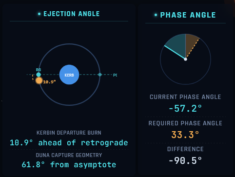
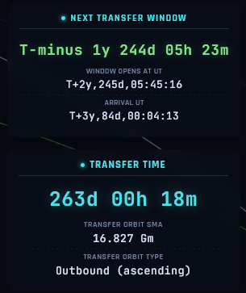
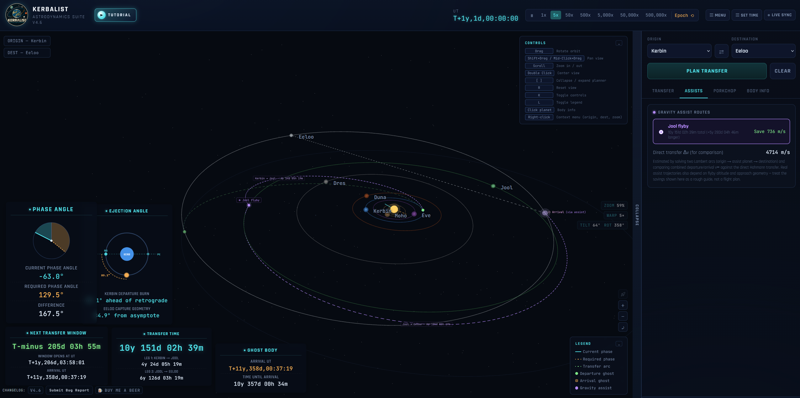
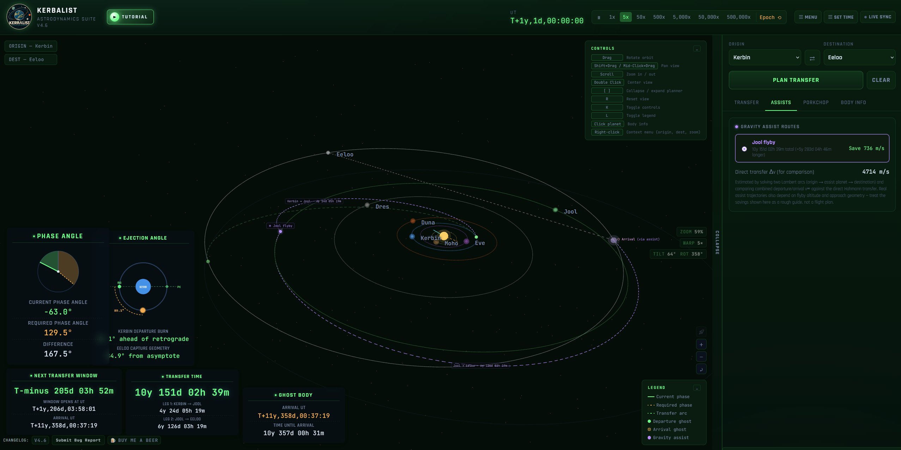
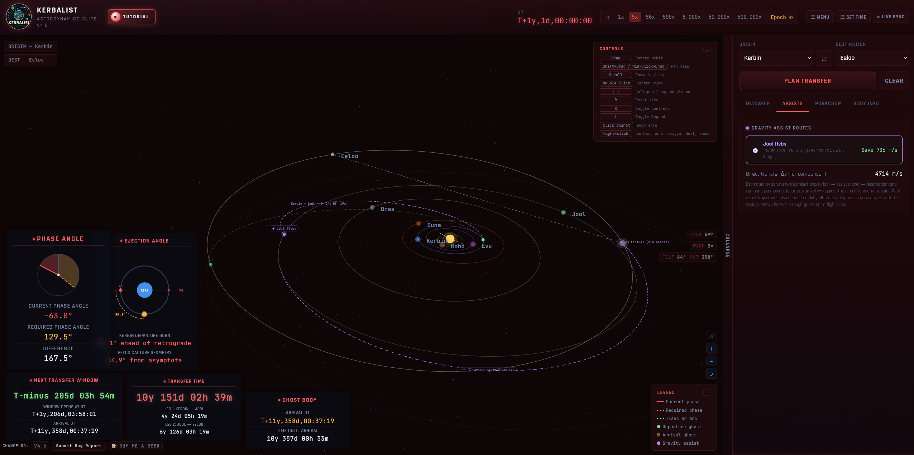
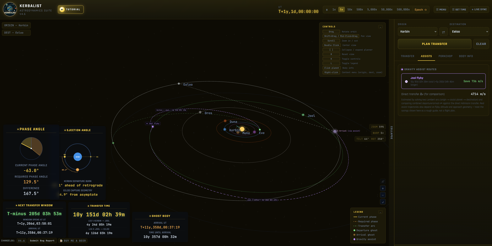

# Kerbalist v4.8

Astrodynamics Suite for Kerbal Space Program 2 Redux

Kerbalist helps you plan efficient transfers between planets in Kerbal Space Program. Calculate transfer windows, ejection angles, and capture requirements all in one tool.

## What it does

Kerbalist is a planner for moving between planets and moons in Kerbal Space Program 2. You pick where you're leaving from and where you're going, and it works out when to leave, how long the trip takes, and roughly how much fuel (ΔV) you'll need.

It's built for planning, not for flying. Keep it open next to the game, or connect it to a running game and let it follow the clock.

### Planning a transfer

- **Next window:** Finds the next time the origin and destination line up for a transfer, with the countdown, the window opening time and the arrival time.
- **Trip numbers:** Flight time, the transfer orbit's size, the departure and arrival v∞, the landing burn and the total ΔV budget. These come from a patched-conic model that treats each planet's orbit as a circle, so expect numbers close to the game rather than identical to it.
- **Phase and ejection angles:** How far off the bodies are from the timing you need, and where to burn on the parking orbit. The cards show a diagram so you can see the geometry at a glance.
- **Return trips:** Plans the way back as well. You get the wait before the return window, the return departure and arrival times, and the round-trip ΔV. You can also shift the time you spend on the target planet.
- **Gravity assists:** When an intermediate planet is in a useful position, Kerbalist suggests it as an optional route and shows the first leg on the map.
- **Porkchop plot:** A map of ΔV against departure and arrival dates, so you can see the cheap windows at a glance.

### Looking at the system

- **3D map:** Planets, moons, orbits, the transfer arc, phase lines and a ghost marker for where the destination will be when you arrive.
- **Body info:** Click any planet or moon for its basic data.
- **Floating cards:** Pin the window, phase, ejection, transfer time and ghost body cards anywhere on the map. Their positions and open or closed state are saved, and the header menu has a reset if you want the default layout back.
- **Keyboard and mouse:** Drag to rotate, scroll to zoom, double-click to centre on a body, right-click for quick origin and destination picks. Press **K** to hide the controls, **L** for the legend, **R** to reset the view, and **[** or **]** to collapse the planner.

### With KSP2 running

- **Live sync:** Connect to the Kerbalist Telemetry Bridge mod and the time, planet and moon positions, and your current vessel all come straight from the game. Once connected, the planner recalculates from the game's own positions, so the numbers and the map agree.
- **Vessel layer:** Your active vessel gets its own orbit line, marker and HUD card, work in progress for extracting a full map of all vessels and bases as well as their network connection.
- **Watch a save file:** No mod needed. Pick your KSP2 save file and Kerbalist re-reads it every few seconds to pick up the time after each autosave. This works in Chrome and Edge only.
- **Game calendar:** Shows the in-game date, and the Epoch button jumps back to the calendar start.

### Making it yours

- **Themes:** Cyan (default), Red, Yellow and Green. The choice is remembered.
- **Tutorial:** A short animated walkthrough of the main features, opened from the header.
- **Community stats:** An anonymous count of users and planned transfers, shown in the header. It's on by default, and you can turn it off in the menu.
- **Bug reports:** The **Submit Bug Report** button opens a GitHub issue pre-filled with your environment details. Paste or drop a screenshot and it's copied to your clipboard for you to attach.

### Themes

The app ships with four colour themes — green, cyan, red, and yellow — applied across the entire UI.

## Getting Started

1. Open the tutorial from the header for a quick tour.
2. Pick an origin and destination, then press **Plan Transfer**.
3. The map shows the transfer arc and the phase angle; the cards show the numbers.
4. Pin the cards to the map if you want them in view while you fly.

## Live Sync with KSP2

Live sync needs the **Kerbalist Telemetry Bridge** mod running inside KSP2. It sends the game's time, planet and moon positions and the active vessel to Kerbalist while the game runs.

1. Download the mod from the [release page](https://github.com/BlocDigital/KerbalistTelemetryBridge/releases/).
2. Install it by following the instructions on that release page.
3. Start KSP2 with the mod enabled and load a save.
4. In Kerbalist, open the time panel, choose **KSP2 Telemetry Bridge** and press **Connect**. The default address `ws://127.0.0.1:8765/ws` works unless you have changed the mod's port.

While live sync is on, the time buttons show a LIVE SYNC overlay, because the game drives the clock.

## Version History

- **v4.8** (2026-10-25): Live sync planner numbers and positions follow the game, header time follows the game clock, fixes for the active-vessel HUD and community stats
- **v4.7** (2026-10-22): Anonymous usage stats (on by default, turn off in the menu), assist route phase and ejection cards, theme colours for the top bar and sidebar
- **v4.6** (2026-10-21): Header menu with themes (Cyan, Red, Yellow, Green), tutorial button restyle, HUD text and diagram fitting, game calendar
- **v4.5** (2026-10-21): Tutorial video
- **v4.4** (2026-10-18): Active vessel orbit line, vessel marker on its orbit, apoapsis and periapsis from the bridge, game calendar, small-body halos
- **v4.3.1** (2026-10-18): Fixed active vessel apoapsis and periapsis
- **v4.3** (2026-10-18): Active vessel HUD element, vessel tag, Settings tab with HUD layout reset, live sync overlay, game orbits in live sync, HUD scaling
- **v4.2** (2026-10-17): Live sync from the [KSP2 Telemetry Bridge](https://github.com/BlocDigital/KerbalistTelemetryBridge/releases/), active vessel HUD
- **v4.1** (2026-10-07): HUD Widgets — pin transfer info cards to the map
- **v4.0** (2026-10-03): Exact transfer numbers, bug report system
- [See full changelog](CHANGELOG.md)

## Technical

- Single-file web app (no dependencies)
- Modular source code in `src/parts/` (54 files, none over ~600 lines)
- Built with Three.js for 3D visualization
- Includes physics tests and CI checks
- Works offline

## Browser Support

Modern browsers with WebGL support. Desktop and tablet recommended (mobile map rendering not yet supported).

## Known Limitations

- Transfers are flat (coplanar). Moho and Eeloo won't intercept exactly due to their orbital tilt.
- Return-trip estimates use simplified circular-orbit calculations.

## License

Copyright (c) 2026 - Kerbol Astrodynamics Team - Bloc Digital

---

**Report bugs**: Click the "Submit a bug" button in the bottom-left, or [open an issue on GitHub](https://github.com/blocdigital/kerbalist/issues).
